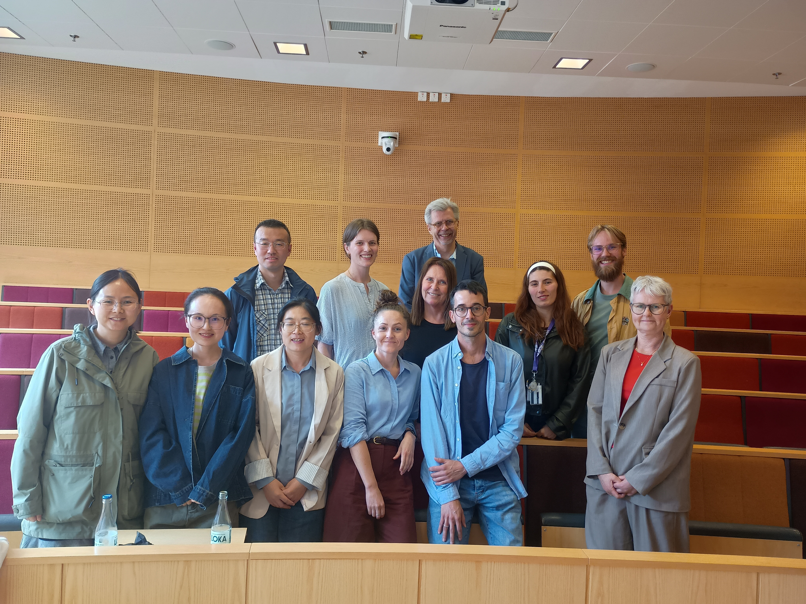



<!-- ## **Welcome to** -->
<h3 class="page__title" style="font-variant:small-caps;">Welcome to</h3>
<h4 class="page__subtitle">Sahlgrenska Perinatal Laboratory</h4>

 

    <table class="wsite-multicol-table">
      <tbody class="wsite-multicol-tbody">
        <tr class="wsite-multicol-tr">
          <td class="wsite-multicol-col" style="width:66.363636363636%; padding:0 15px;">
            

              About 10 500 babies are born at Sahlgrenska University Hospital each year. The hospital is also a regional referral unit for the Western Health Care Region of Sweden. This creates a very good base for research within the area of Pregnancy and Delivery. We also have a unique collaboration with the Norwegian Mother Child Cohort Study that has created favorable conditions for epidemiological and genetic research. 
              The Perinatal Laboratory, led by professor Bo Jacobsson, studies different aspects of both pregnancy and delivery. The main focus is epidemiology, genetics, biomarkers and mechanisms of spontaneous preterm delivery.
            

          </td>
          <td class="wsite-multicol-col" style="width:66.363636363636%; padding:0 15px;">
            
          </td>
        </tr>
      </tbody>
    </table>

